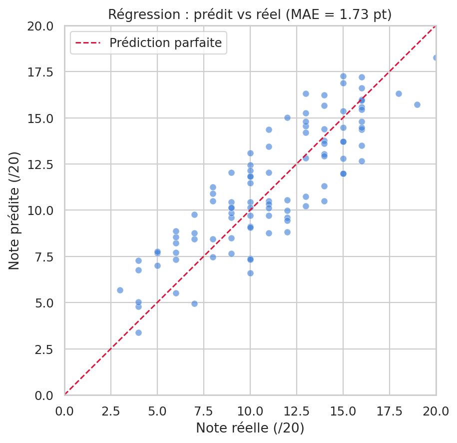
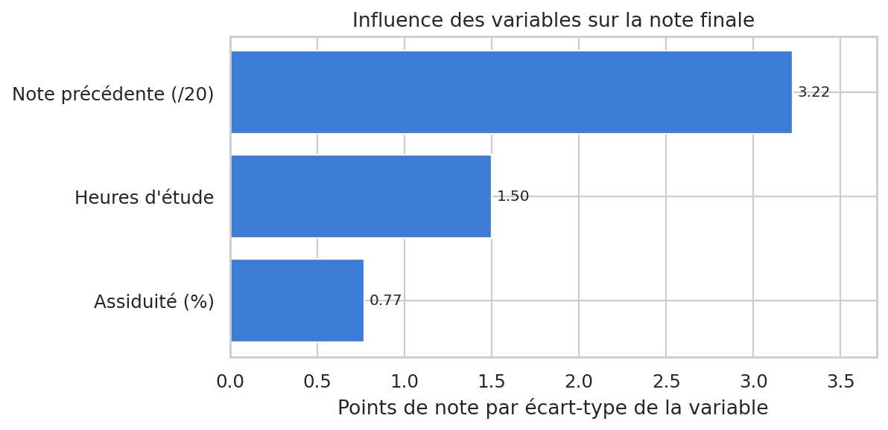
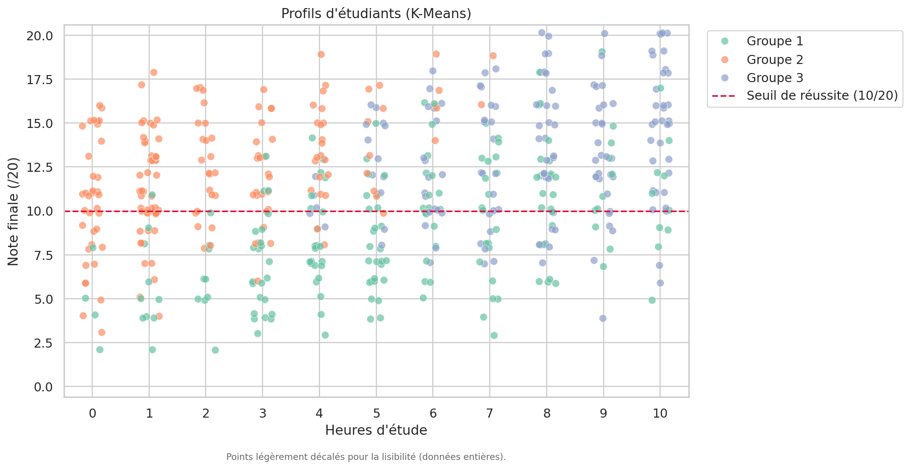
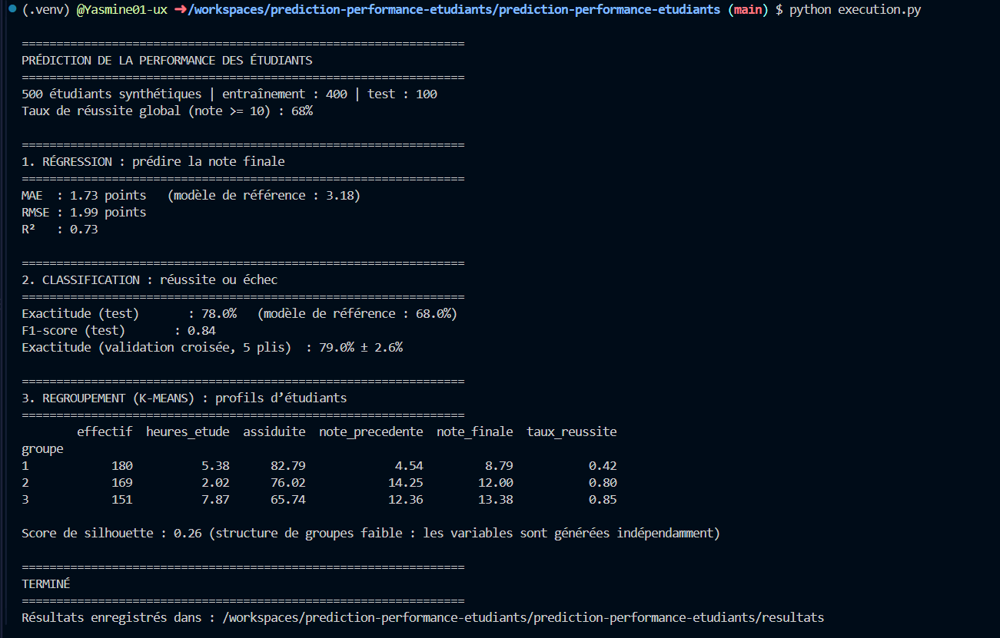

# Prédiction de la performance des étudiants

Projet de machine learning reproductible consacré à l’exploration de la performance étudiante à l’aide de la **régression**, de la **classification** et du **regroupement (clustering)**. Il couvre les principales étapes d’un flux de travail : génération de données synthétiques, séparation entraînement/test, comparaison à des modèles de référence, évaluation, visualisation et export des résultats.

> **À retenir :** les données sont synthétiques et générées à partir d’une formule connue. Ce projet illustre une démarche de machine learning ; ses résultats ne constituent pas des conclusions sur de vrais étudiants.


## Vue d’ensemble

| Tâche | Méthode | Question étudiée |
| --- | --- | --- |
| Régression | StandardScaler + régression linéaire | Quelle note finale le modèle estime-t-il ? |
| Classification | Forêt aléatoire (Random Forest) | La note finale est-elle supérieure ou égale au seuil de réussite de 10/20 ? |
| Regroupement | StandardScaler + K-Means | Quels profils exploratoires apparaissent dans les données ? |

# Résultats et démonstration
## 1. Résultats visuels

Les graphiques et les fichiers d’évaluation sont enregistrés dans `resultats/`.

**Notes prédites et notes réelles**

<p align="center">
  
</p>

**Influence relative des variables dans la régression**

<p align="center">
  
</p>

**Profils exploratoires des étudiants**

<p align="center">
  
</p>

## 2. Résultats dans la console Linux

Exécution du programme dans le terminal Linux 
``python execution.py``

Sortie du programme :
<p align="center">
  
</p>
# Fonctionnalités

- Génération reproductible de 500 observations synthétiques à l’aide d’une graine aléatoire fixe.
- Prédiction d’une note numérique par régression et prédiction réussite/échec par classification.
- Comparaison des modèles avec des modèles de référence simples.
- Validation croisée à cinq plis pour la classification.
- Regroupement K-Means après standardisation des variables.
- Export des métriques au format JSON et des profils de groupes au format CSV.
- Tests automatisés de validité, de reproductibilité et de comportement des modèles.

## Installation et exécution

### Prérequis

- Python 3.10 ou version ultérieure
- `pip`

### Installer le projet

```bash
git clone <url-de-votre-depot>
cd prediction-performance-etudiants
python -m venv .venv
```

Activer l’environnement virtuel :

```powershell
# Windows PowerShell
.venv\Scripts\Activate.ps1
```

```bash
# macOS / Linux
source .venv/bin/activate
```

Installer les dépendances et lancer le programme :

```bash
python -m pip install --upgrade pip
pip install -r requirements.txt
python execution.py
```

Le terminal affiche un résumé des évaluations. Les graphiques et fichiers de résultats sont générés dans `resultats/`.

### Exécuter les tests

```bash
pip install pytest
python -m pytest
```

## Structure du dépôt

```text
prediction-performance-etudiants/
├── execution.py                         # Point d’entrée du programme
├── requirements.txt                     # Dépendances Python
├── .gitignore                           # Fichiers ignorés par Git
├── source/
│   ├── __init__.py
│   ├── configuration.py                 # Paramètres et variables communes
│   ├── donnees.py                       # Génération et séparation des données
│   ├── modeles.py                       # Entraînement et évaluation des modèles
│   └── visualisations.py                # Création des graphiques
├── tests/
│   └── test_chaine_traitement.py         # Tests essentiels du projet
└── resultats/
    ├── metriques.json                   # Métriques d’évaluation
    ├── profils_groupes.csv               # Statistiques descriptives des groupes
    └── graphiques/
        ├── notes_predites_reelles.png
        ├── influence_variables.png
        └── profils_etudiants.png
```

## Méthodologie

### Données

Le projet génère 500 observations synthétiques à partir de trois variables explicatives :

- `heures_etude` : nombre d’heures d’étude, de 0 à 10 ;
- `assiduite` : taux d’assiduité, de 50 % à 100 % ;
- `note_precedente` : note précédente, de 0 à 20.

La variable cible `note_finale` est calculée à partir d’une combinaison pondérée de ces variables, à laquelle s’ajoute un bruit aléatoire. La note est ensuite limitée à l’intervalle de 0 à 20. Comme la formule est connue, les performances doivent être interprétées comme une démonstration contrôlée.

### Évaluation

- 80 % des données pour l’entraînement et 20 % pour le test ;
- stratification selon la réussite ou l’échec lors du découpage ;
- régression : erreur absolue moyenne (MAE), racine de l’erreur quadratique moyenne (RMSE) et coefficient de détermination (R²) ;
- classification : exactitude (*accuracy*) et F1-score ;
- validation croisée à cinq plis pour la classification ;
- modèles de référence simples pour contextualiser les résultats.

### Regroupement

K-Means regroupe les observations à partir des variables explicatives standardisées. Les groupes sont ensuite numérotés selon leur note finale moyenne afin de faciliter la lecture des tableaux. Le regroupement reste exploratoire ; le score de silhouette aide à estimer la séparation entre les groupes.

## Limites connues

- Les données sont artificielles ; les performances ne garantissent pas une généralisation à des données éducatives réelles.
- La note cible dépend des variables d’entrée selon une formule prédéfinie : les modèles apprennent donc une relation intégrée au générateur.
- Les groupes représentent des tendances dans ce jeu de données synthétique et ne doivent pas être considérés comme des catégories validées d’étudiants.
- Les coefficients du modèle décrivent des associations dépendantes du modèle et ne démontrent pas de causalité.

## Améliorations envisagées

- Évaluer les modèles sur un jeu de données réel et documenté, par exemple celui de performance étudiante de l’UCI, après vérification de sa licence et de sa documentation.
- Ajouter une validation croisée pour la régression et comparer des modèles régularisés ou des modèles à base d’arbres.
- Optimiser les hyperparamètres avec une stratégie évitant toute fuite d’information depuis l’ensemble de test.
- Ajouter une interface interactive simple avec Streamlit.
- Mettre en place une intégration continue pour exécuter les tests à chaque mise à jour du dépôt.

## Technologies utilisées

`Python` · `pandas` · `NumPy` · `scikit-learn` · `Matplotlib` · `Seaborn` · `pytest`

## Pour les personnes qui évaluent le projet

Ce projet de portfolio met l’accent sur la séparation des responsabilités, la reproductibilité, la comparaison à des modèles de référence, l’évaluation et la présentation transparente des limites. **Aucune donnée personnelle ou donnée réelle d’étudiant n’est utilisée.**
